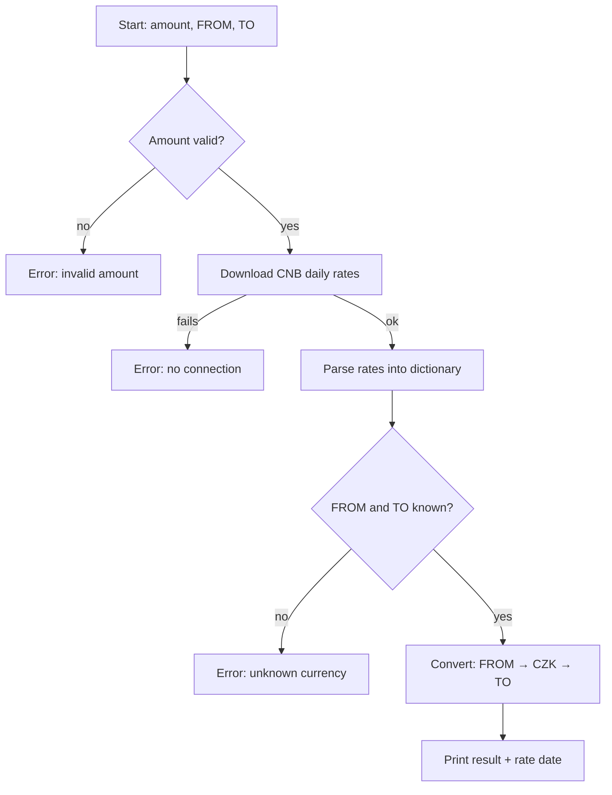

# Program proposal

## Purpose
A command-line currency converter that converts an amount between two
currencies using today's official exchange rates from the Czech National Bank (CNB).

## Input 1 
- Amount (positive number)
- Source currency code (e.g. EUR)
- Target currency code (e.g. USD)

Example: `python main.py 100 EUR USD`

## Output
- Converted amount rounded to 2 decimals
- Date of the exchange rates used

Example: `100.00 EUR = 110.11 USD (CNB rates from 04 Nov 2026)`

## Logic
All CNB rates are given relative to the Czech koruna (CZK), so the
conversion goes through CZK: source currency → CZK → target currency.

Some rates are quoted per 100 units (e.g. JPY), so the unit must be
taken into account.

## Modules
- **fetcher.py**: downloads the daily rates from the CNB API (HTTP GET, plain text)
- **parser.py**: turns the text into a dictionary `{code: (unit, rate)}`
- **converter.py**: converts the amount via CZK
- **main.py**: reads the arguments, runs everything, prints the result

## Errors handled
- Invalid amount (not a number, zero or negative)
- Unknown currency code
- No internet connection / CNB not reachable

## Target users
Students, travelers, anyone who needs a quick conversion with official rates.

## Program flow

